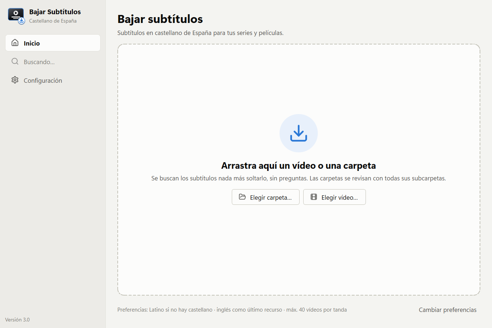
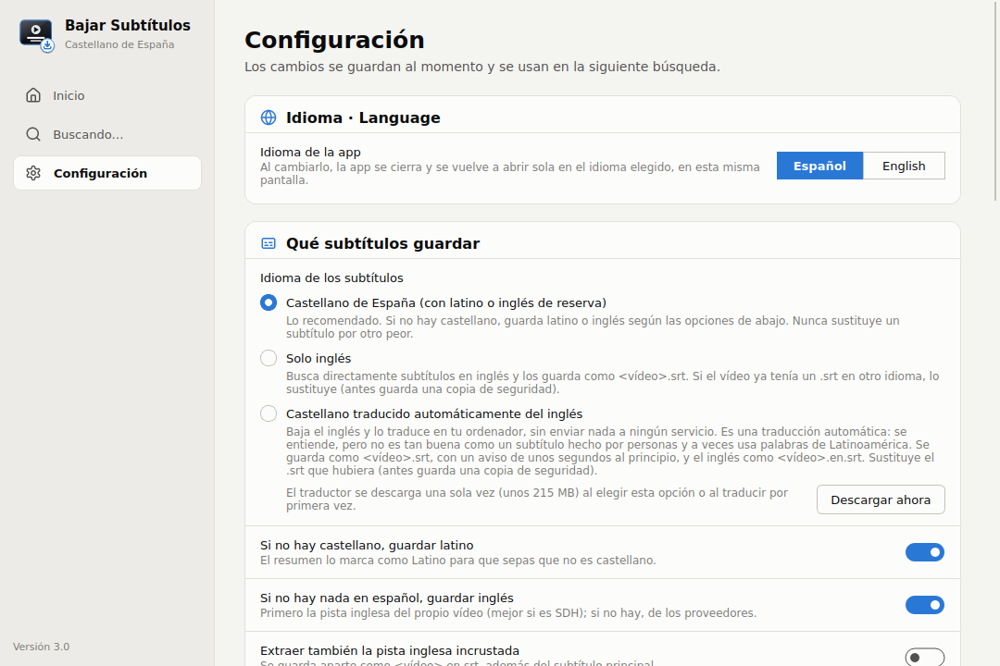
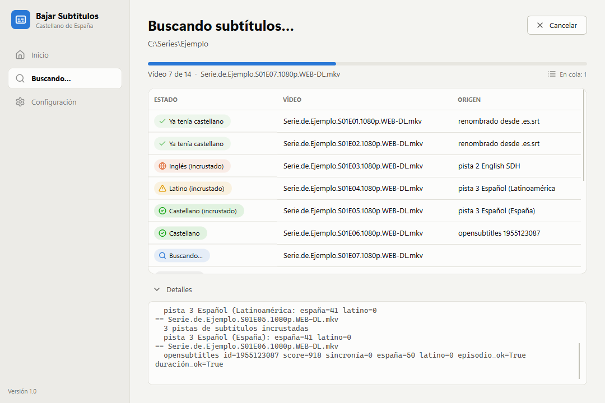
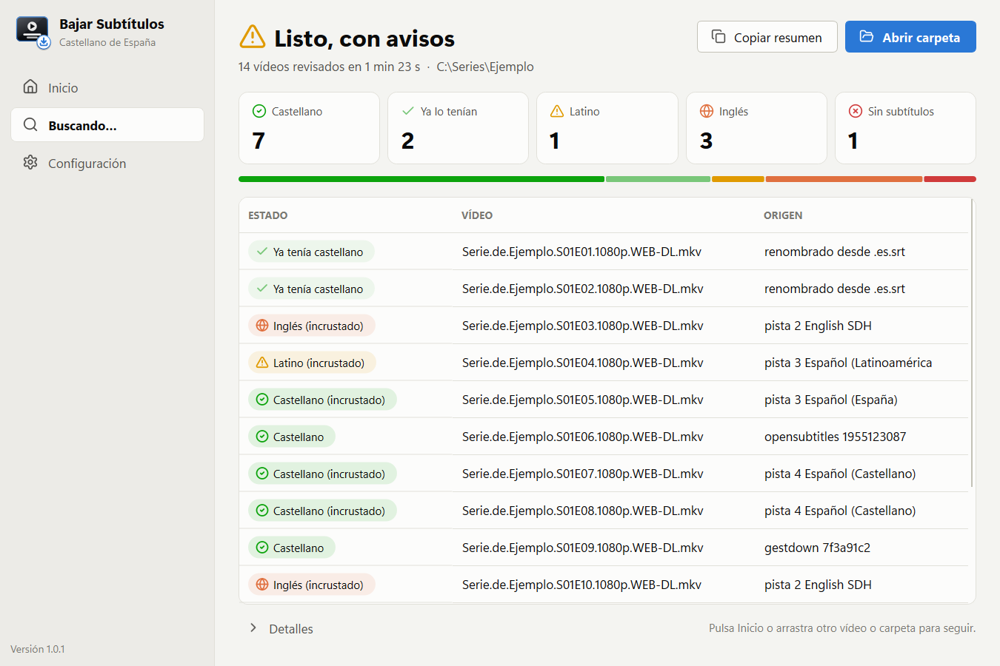

# Bajar Subtítulos ESP

Aplicación de escritorio para **Windows 10 y 11** y, desde la versión 1.5.0, para **Linux**, que
descarga subtítulos en **castellano (español de España)** para tus series y películas. Arrastras un
vídeo o una carpeta a la ventana y se ocupa de todo, sin preguntas. También funciona con el botón
derecho del ratón en el Explorador de Windows o en el gestor de archivos de Linux, sin abrir antes la
app.

La app está en **castellano o en inglés** (*English*): se elige al instalarla y se cambia en
Configuración.



## Qué hace

- **Mira primero dentro del vídeo.** Si el `.mkv` o el `.mp4` trae una pista de subtítulos en
  castellano, la extrae. Es lo mejor, porque va sincronizada al milímetro. Lo hace sin ffmpeg y
  en segundos, aunque el vídeo ocupe varios GB. Si el disco es lento (una unidad USB, un NAS o una
  carpeta de red) y extraerla fuese a tardar más de 15 segundos, no lo hace y busca en internet; en
  *Detalles* se indica.
- Si no la trae, **busca en internet**: opensubtitles.org (si tienes cuenta), Addic7ed, Gestdown y
  Subtitulamos; y, si con ellos no hay castellano, opensubtitles.com (si tienes cuenta). Descarga los mejores candidatos y se queda con el que es **castellano de España**.
  Para eso comprueba el vocabulario (vosotros, vale, móvil… frente a ustedes, celular, computadora…),
  porque las etiquetas de idioma de las webs no son fiables. También descarta los subtítulos de
  otro episodio o con una duración que no encaja.
- Prefiere **castellano > latino > inglés**, y nunca sustituye un subtítulo por otro peor. Si solo
  hay latino, o solo inglés, lo guarda y te lo marca en el resumen.
- Guarda el subtítulo como **`<vídeo>.srt`**, con el mismo nombre que el vídeo, para que cualquier
  reproductor lo cargue solo. Si sustituye uno que ya existía, guarda antes una copia de seguridad.
- **Respeta a los proveedores**: como mucho 40 vídeos buscan en internet en cada tanda y como
  mucho 5 descargas por vídeo, con una pausa entre vídeos. Lo que pase del límite queda como
  *Pendiente* para la próxima vez.

Hace lo mismo que la skill
[`bajar-subtitulos-esp`](https://github.com/subtitulos-castellano/bajar-subtitulos-esp) (para Claude
Code, Codex y OpenCode), de la que parte este proyecto. La única diferencia es ese límite de 15
segundos para extraer la pista de un vídeo en un disco lento.

## Instalar

Descarga la última versión desde **Releases**. Windows y Linux tienen siempre el mismo número de
versión. Cada Release trae **`INSTALAR-<versión>.txt`**, con estas mismas instrucciones resumidas
(también las de desinstalar, en castellano y en inglés) y los nombres de los archivos de esa versión
ya escritos: en Linux basta con copiar la línea de tu distribución y pegarla en un terminal abierto en
la carpeta de la descarga.

### Windows

- **`BajarSubtitulosESP-<versión>-instalador.exe`**: lo instala para tu usuario (no pide permisos de
  administrador) y crea los accesos directos. Se desinstala desde *Configuración de Windows ›
  Aplicaciones*.
- **`BajarSubtitulosESP-<versión>-portable.zip`**: descomprímelo donde quieras y abre
  `BajarSubtitulosESP.exe`. No instala nada.

La primera vez que se instala, el instalador pregunta el idioma (**Español** o **English**; propone el
de Windows), que es también el de la app. Al actualizar ya no pregunta: se queda el de antes. La
versión portable empieza en castellano.

El programa no está firmado digitalmente, así que la primera vez Windows puede mostrar
**"Windows protegió su PC"**. Pulsa *Más información › Ejecutar de todas formas*.

### Linux

Para PC de 64 bits (x86_64) con una distribución de 2022 o posterior (glibc 2.34 o más nueva). Elige
el archivo según tu distribución:

| Distribución | Archivo | Cómo instalarlo |
|---|---|---|
| Ubuntu 22.04 o posterior, Debian 12 o posterior, Linux Mint 21 o posterior y derivadas | `BajarSubtitulosESP-<versión>-amd64.deb` | `sudo apt install ./BajarSubtitulosESP-<versión>-amd64.deb` |
| Fedora, AlmaLinux, Rocky Linux o RHEL 9 o posterior | `BajarSubtitulosESP-<versión>-x86_64.rpm` | `sudo dnf install ./BajarSubtitulosESP-<versión>-x86_64.rpm` |
| openSUSE Tumbleweed | `BajarSubtitulosESP-<versión>-x86_64.rpm` | `sudo zypper install --allow-unsigned-rpm ./BajarSubtitulosESP-<versión>-x86_64.rpm` |
| Cualquier otra (Arch, Manjaro…), o si no quieres instalar nada | `BajarSubtitulosESP-<versión>-x86_64.AppImage` | `chmod +x` y ábrelo (abajo) |

- **`.deb` y `.rpm`:** el gestor de paquetes instala también lo que haga falta del sistema. La app
  queda en el menú de aplicaciones (*Bajar Subtítulos ESP*) y en la orden `bajar-subtitulos-esp`. Se
  desinstala con `sudo apt remove bajar-subtitulos-esp`, `sudo dnf remove bajar-subtitulos-esp` o
  `sudo zypper remove bajar-subtitulos-esp`. Al desinstalarse del todo (no al actualizar), quita además,
  a cada usuario del equipo, el menú contextual, los accesos que le haya puesto en el escritorio y en la
  barra de tareas de Plasma, y la nota que deja KDE si la quitó del menú de aplicaciones: así, al
  reinstalarla, vuelve a aparecer en él.
- **AppImage:** un solo archivo con todo dentro. Dale permiso de ejecución y ábrelo:

  ```bash
  chmod +x BajarSubtitulosESP-<versión>-x86_64.AppImage
  ./BajarSubtitulosESP-<versión>-x86_64.AppImage
  ```

  No necesita `libfuse2`. La primera vez pregunta si lo añades al menú de aplicaciones. Para
  desinstalarlo, en su carpeta, `./BajarSubtitulosESP-<versión>-x86_64.AppImage --desinstalar` (quita lo
  mismo que el `.deb` y el `.rpm`, y su entrada del menú de aplicaciones) y bórralo. La línea exacta está
  en `INSTALAR-<versión>.txt`.
- **`BajarSubtitulosESP-<versión>-linux-x86_64.tar.gz`:** la misma carpeta, comprimida. Descomprímela y
  abre `bajar-subtitulos-esp/bajar-subtitulos-esp`. No se actualiza sola.

Está probada en Ubuntu 22.04, 24.04 y 26.04, Debian 12 y 13, AlmaLinux 9 y 10, Fedora, openSUSE
Tumbleweed y Arch (el AppImage), con X11 y con Wayland, y en los escritorios KDE Plasma, GNOME y
Cinnamon.

La app empieza en castellano; el idioma se cambia en Configuración.



### Comprobar la descarga

Cada Release incluye **`SHA256SUMS.txt`** con la huella SHA-256 de cada archivo. En Windows, en
PowerShell:

```powershell
Get-FileHash .\BajarSubtitulosESP-<versión>-instalador.exe
```

En Linux, en la carpeta de la descarga (con `SHA256SUMS.txt` al lado):

```bash
sha256sum -c --ignore-missing SHA256SUMS.txt
```

El resultado tiene que coincidir con la línea de ese archivo en `SHA256SUMS.txt` (en Linux, tiene que
decir `La suma coincide` u `OK`). Si no coincide, el archivo está dañado o no es el original: no lo
abras.

Desde la versión 1.0.1, cada archivo tiene además una **atestación de procedencia** de GitHub. Esta
atestación demuestra que el archivo lo compiló GitHub Actions a partir del código de este
repositorio, y no lo subió nadie a mano. Para comprobarla, con [GitHub CLI](https://cli.github.com/):

```powershell
gh attestation verify .\BajarSubtitulosESP-<versión>-instalador.exe -R subtitulos-castellano/bajar-subtitulos-esp-app
```

En Linux, igual con el archivo que hayas descargado:

```bash
gh attestation verify BajarSubtitulosESP-<versión>-x86_64.rpm -R subtitulos-castellano/bajar-subtitulos-esp-app
```

## Usar

1. **Arrastra** un vídeo, varios vídeos o una carpeta (con todas sus subcarpetas) a cualquier
   parte de la ventana. Lo que sueltas de una vez se revisa junto, como si estuviera en la misma
   carpeta. También puedes usar *Elegir carpeta…* o *Elegir vídeo…*.
2. La búsqueda empieza sola. Verás:
   - todos los vídeos en la tabla, primero *En espera*;
   - el que se está revisando, como *Buscando…*;
   - cómo cada uno cambia a su resultado.

   *Detalles* muestra lo que hace el programa por detrás. **Cancelar** para al momento (lo ya
   guardado se queda guardado). Si arrastras algo más mientras busca, se pone en cola.



3. Al terminar, el **resumen** muestra cuántos vídeos hay de cada tipo. Pulsa una tarjeta para ver
   solo esos vídeos. También puedes *Copiar resumen* o *Abrir carpeta*, y con *Inicio* vuelves a
   la pantalla del principio.

| Estado | Qué significa |
|---|---|
| 🟢 **Castellano** | Subtítulo en castellano guardado ahora (de internet o de una pista del propio vídeo) |
| 🟢 **Ya lo tenían** | Ya había un subtítulo en castellano: no se toca |
| 🟠 **Latino** | Solo había español latino y se ha guardado (se puede desactivar) |
| 🟠 **Inglés** | No había nada en español y se ha guardado inglés (se puede desactivar) |
| ⚪ **Sin cambios** | Ya tenía latino o inglés y no se ha encontrado nada mejor |
| 🟣 **Pendientes** | Superan el límite de vídeos por tanda: *Procesar pendientes* los busca |
| 🔴 **Sin subtítulos** | No se ha encontrado nada |



### Desde el Explorador de Windows

Con el **botón derecho del ratón**, sin abrir antes la app:

- En una **carpeta** (o en el fondo de una carpeta abierta, o en una unidad): *Bajar subtítulos
  aquí › Solo esta carpeta* o *Esta carpeta y sus subcarpetas*.
- En **uno o varios vídeos** seleccionados: *Bajar subtítulos*. Todos los seleccionados se revisan
  en una sola búsqueda. En los `.ts` no aparece, porque esa extensión también es de TypeScript; esos
  vídeos se buscan con el menú de su carpeta o arrastrándolos a la app.

En **Windows 11** estas opciones están dentro de *Mostrar más opciones* (o con Mayús + clic
derecho): el menú corto de Windows 11 solo admite programas firmados digitalmente.

Según *Configuración › Menú contextual del Explorador*, la búsqueda:

- **Muestra la ventana** (por defecto): igual que si arrastras los vídeos a la app.
- O va **en segundo plano**: no se abre la ventana. Mientras busca, hay un icono junto al reloj;
  desde él puedes ver el progreso o cancelar. Al terminar, un aviso de Windows muestra el resumen
  (cuántos en castellano, latino, sin subtítulos…), y al pulsarlo se abre. Los `.srt` aparecen
  junto a los vídeos.

Si la app ya está abierta, lo que pides desde el menú va a su cola.

**Versión instalada y portable (Windows).** El menú abre una sola de las dos, y manda la instalada:

- El instalador añade el menú, también al actualizar, aunque lo tuviera la portable. Solo lo deja
  sin añadir si lo has desactivado en Configuración.
- El desinstalador lo quita, apunte a la que apunte.
- La portable solo lo añade si lo activas en su *Configuración*. Si mueves su carpeta, ábrela una
  vez para que el menú apunte al nuevo sitio. **Antes de borrar su carpeta, desactiva ahí el menú**:
  si no, se queda apuntando a un programa que ya no existe (hasta que abras la app otra vez, que lo
  arregla).

### Desde el gestor de archivos de Linux

También con el **botón derecho del ratón**:

- **Dolphin** (KDE) y **Nemo** (Cinnamon): en una carpeta, o en el fondo de una carpeta abierta,
  *Bajar subtítulos aquí › Solo esta carpeta* o *Esta carpeta y sus subcarpetas*; en uno o varios
  vídeos, *Bajar subtítulos*.
- **Nautilus** (GNOME) no deja añadir opciones propias al menú, solo *scripts*: están en *Scripts ›
  Bajar subtítulos* (lo seleccionado, con sus subcarpetas, o la carpeta abierta si no hay nada
  seleccionado) y *Bajar subtítulos (solo esta carpeta)*.

Con el `.deb` y el `.rpm`, el menú se pone solo la primera vez que abres la app. Con el AppImage y el
`.tar.gz`, actívalo en *Configuración › Menú contextual del gestor de archivos*. Funciona igual que en
Windows: varios vídeos son una sola búsqueda, y puede mostrar la ventana o buscar en segundo plano.

Si desinstalas la app o borras el AppImage, el menú se quita solo la primera vez que lo uses. Si mueves
el AppImage, ábrelo una vez desde su nuevo sitio y el menú lo seguirá.

## Configuración

Los cambios se guardan al momento y se usan en la siguiente búsqueda.

| Opción | Por defecto |
|---|---|
| Idioma de la app: Español o English | El elegido al instalar (portable y Linux: Español) |
| Si no hay castellano, guardar latino | Sí |
| Si no hay nada en español, guardar inglés (primero la pista del vídeo, mejor si es SDH) | Sí |
| Extraer también la pista inglesa incrustada como `<vídeo>.en.srt` | No |
| Rehacer aunque ya haya castellano | No |
| Modo simulación (muestra qué haría sin escribir nada) | No |
| Vídeos que buscan en internet en cada tanda | 40 |
| Candidatos que se descargan por vídeo | 5 |
| Cuenta de opensubtitles.org (opcional, da más resultados) | — |
| Cuenta de opensubtitles.com (opcional, solo como último recurso) | — |
| Al cerrar la ventana, seguir junto al reloj | No |
| Tema: Sistema, Claro u Oscuro | Sistema |
| Tamaño del texto: como Windows o un porcentaje propio (en Linux, solo el porcentaje) | Como Windows (en Linux, 100 %) |
| Mostrar «Bajar subtítulos» en el menú contextual | Sí (instalador, `.deb` y `.rpm`), No (portable, AppImage y `.tar.gz`) |
| Mostrar en el menú de aplicaciones (solo el AppImage) | Lo pregunta la primera vez |
| Al usar el menú contextual: mostrar la ventana o en segundo plano | Mostrar la ventana |
| Buscar actualizaciones automáticamente | Sí |


**Idioma:** al cambiarlo, la app se cierra y se vuelve a abrir sola en el idioma elegido, en la misma
pantalla de Configuración. Cambia todo: la interfaz, los avisos (también las novedades de las
actualizaciones), el registro de *Detalles* y el menú contextual del Explorador. No se puede cambiar
durante una búsqueda. Es la única forma de cambiarlo en la versión portable.

**Cuentas de OpenSubtitles:** opensubtitles.org y opensubtitles.com son cuentas distintas; puedes
poner una, las dos o ninguna. Las contraseñas se guardan en el **Administrador de credenciales de
Windows** o, en Linux, en el **llavero del escritorio** (KWallet en KDE, GNOME Keyring en GNOME y
otros), nunca en un archivo. Si usas la skill, *Usar la cuenta de la skill* importa cada una de su
`credenciales.json` (`"opensubtitles"` y `"opensubtitlescom"`).

opensubtitles.com solo se usa como **último recurso**, porque sus cuentas solo permiten unas pocas
descargas al día:

- se le piden subtítulos solo si los demás no han encontrado castellano (o, al final, inglés), y
  para en cuanto encuentra un castellano válido;
- *Detalles* dice cuántas descargas quedan hoy;
- si se agota el cupo (o no acepta la cuenta), lo dice y no se le pide nada más en esa búsqueda;
- se usa el nombre de usuario, no el email.

**Tamaño del texto:** en Windows, por defecto sigue a *Configuración de Windows › Accesibilidad ›
Tamaño del texto*, como el Explorador. Si lo cambias allí, la app se ajusta al volver a ella. En Linux
la app se ve al tamaño normal del sistema (100 %) y puedes subirlo o bajarlo con un porcentaje.

**Seguir junto al reloj en Linux:** KDE Plasma, Cinnamon y XFCE muestran el icono directamente. GNOME
necesita la extensión *AppIndicator and KStatusNotifierItem Support* (Ubuntu ya la trae activada). Si
el escritorio no muestra iconos junto al reloj, la opción sale desactivada con la explicación, y el
menú contextual siempre abre la ventana.

### Actualizaciones

Al abrir la app, como mucho una vez al día, mira en GitHub si hay una versión nueva. Si la hay,
lo avisa arriba de la ventana, con sus novedades:

- **Actualizar** descarga el instalador y comprueba que su huella SHA-256 coincide con la que
  publica GitHub. Si coincide, la app se cierra, la versión nueva se instala sola y la app se vuelve
  a abrir. Si no coincide, no se instala nada.
- **Más tarde** cierra el aviso hasta la próxima vez que abras la app.
- Durante una búsqueda no se puede actualizar: espera a que termine.
- **Versión portable:** solo avisa y abre la página de descarga.

En Linux, según cómo la instalaste:

- **`.deb` y `.rpm`:** se descarga el paquete, se comprueba su huella y lo instala el gestor de
  paquetes de tu sistema (`apt`, `dnf` o `zypper`). Una ventana del sistema te pide tu contraseña; si
  la cancelas, la app sigue como estaba. Después, la app se vuelve a abrir.
- **AppImage:** el nuevo se descarga junto al que tienes, se comprueba y lo sustituye. Si su nombre
  llevaba la versión, pasa a llevar la nueva. Si no se puede escribir en su carpeta, solo avisa.
- **`.tar.gz`:** solo avisa y abre la página de descarga.

En *Configuración › Actualizaciones* puedes desactivar la comprobación automática o buscar ahora. La
app solo pregunta a GitHub por la última versión publicada, sin enviar nada tuyo.

## Dónde guarda cada cosa

**Windows:**

| Qué | Dónde |
|---|---|
| Subtítulos | Junto a cada vídeo: `<vídeo>.srt` (y `<vídeo>.en.srt` si se pide) |
| Copias de los subtítulos sustituidos | `%USERPROFILE%\.subtitulos-esp\backup` (la misma carpeta que la skill) |
| Preferencias, tamaño y posición de la ventana | `%APPDATA%\BajarSubtitulosEsp\config.json` |
| Contraseñas de OpenSubtitles | Administrador de credenciales de Windows (`BajarSubtitulosESP/opensubtitles` y `BajarSubtitulosESP/opensubtitlescom`) |
| Menú contextual del Explorador | Registro de tu usuario (`HKCU\Software\Classes`): se quita al desinstalar |
| Instalador de la última actualización y su registro | `%TEMP%\BajarSubtitulosESP-actualizacion` (se borra solo) |

**Linux:**

| Qué | Dónde |
|---|---|
| Subtítulos | Junto a cada vídeo, igual que en Windows |
| Copias de los subtítulos sustituidos | `~/.subtitulos-esp/backup` (la misma carpeta que la skill) |
| Preferencias, tamaño y posición de la ventana | `~/.config/BajarSubtitulosEsp/config.json` |
| Contraseñas de OpenSubtitles | Llavero del escritorio (KWallet o GNOME Keyring), con los mismos nombres que en Windows |
| La app (`.deb` y `.rpm`) | `/opt/bajar-subtitulos-esp`, con la orden `/usr/bin/bajar-subtitulos-esp` |
| Menú contextual | `~/.local/share/kio/servicemenus` (Dolphin), `~/.local/share/nemo/actions` (Nemo), `~/.local/share/nautilus/scripts` (Nautilus) y `~/.local/share/bajar-subtitulos-esp` |
| Entrada del AppImage en el menú de aplicaciones | `~/.local/share/applications/bajar-subtitulos-esp.desktop` y su icono |
| Paquete de la última actualización | `~/.cache/bajar-subtitulos-esp/actualizacion` (se borra solo) |

Al desinstalar, todo esto se conserva (salvo el menú contextual y, en Linux, los accesos del escritorio
y de la barra de tareas): es tuyo y lo comparte la skill.

## Preguntas frecuentes

**No me aparece el aviso de la versión nueva.** La comprobación se hace como mucho una vez al
día. Usa *Configuración › Actualizaciones › Buscar ahora*. La versión 1.0.0 aún no sabía
actualizarse: si la tienes, instala la última a mano una vez.

**Un proveedor da error (por ejemplo, "HTTP error 503. Provider addic7ed" en Detalles).** Ese
servicio no está disponible en ese momento. La app sigue con los demás. Si un vídeo se queda sin
castellano por eso, vuelve a intentarlo más tarde.

**Se ha quedado en latino o en inglés y luego aparece el castellano.** Arrastra la carpeta otra
vez: los vídeos que ya tienen castellano se saltan enseguida y los demás se vuelven a buscar. El
latino o el inglés se sustituyen por castellano en cuanto aparece.

**Quiero revisar más de 40 vídeos de una vez.** Usa *Procesar pendientes* al terminar o, si de
verdad lo necesitas, sube el límite en Configuración. Los proveedores son servicios gratuitos:
mejor no saturarlos.

**No veo «Bajar subtítulos» al hacer clic derecho.** En Windows 11 está dentro de *Mostrar más
opciones*. En Nautilus (GNOME), dentro de *Scripts*. Comprueba también que está activado en
*Configuración › Menú contextual*. En Linux, si acabas de activarlo y no aparece, cierra y vuelve a
abrir el gestor de archivos.

**Sigo viendo «Bajar subtítulos» después de desinstalar o de borrar la versión portable.** Abre la
app (instalada o portable) una vez: si el menú apunta a un programa que ya no existe, lo quita (o,
si lo tienes activado, lo hace apuntar a la que has abierto). Si ya no tienes ninguna, descomprime
la portable, actívalo y desactívalo en Configuración, y bórrala.

**Quiero que la app siga abierta al cerrar la ventana.** Activa *Configuración › Al cerrar la
ventana, seguir junto al reloj*. Cerrar la ventana la oculta y queda un icono junto al reloj: un
clic la vuelve a abrir. Si estaba buscando, sigue y avisa al terminar. Para cerrarla del todo, clic
derecho en el icono › *Salir*.

**En Detalles pone «no se han extraído los subtítulos incrustados del propio vídeo porque leerlo
era muy lento».** El vídeo trae una pista en español, pero está en un disco lento y extraerla iba a
tardar más de 15 segundos. La app lo deja y busca en internet. Si prefieres la pista del vídeo,
copia el vídeo a un disco más rápido y vuelve a buscar.

**Linux: no puedo activar «seguir junto al reloj».** Tu escritorio no muestra iconos junto al reloj.
En GNOME, instala la extensión *AppIndicator and KStatusNotifierItem Support* (en Fedora, el paquete
`gnome-shell-extension-appindicator`) y vuelve a abrir la app.

**Linux en WSL (Windows 11):** la app funciona con WSLg, pero no se pueden arrastrar archivos desde el
Explorador de Windows (usa *Elegir carpeta…* o *Elegir vídeo…*) ni hay icono junto al reloj.

**¿Sube o comparte algo de mis vídeos?** No. Solo consulta a los proveedores el nombre del
episodio o de la película, y lee los vídeos desde tu disco.

---

## Desarrollo

### Estructura

```
app/            interfaz gráfica (Qt / PySide6)
  main.py       arranque (--tema, --idioma, --demo, --captura, --config, --autoprueba, rutas y --menu-*);
                volver a abrirse al cambiar el idioma
  ventana.py    ventana principal, menú lateral, arrastrar y soltar, cola
  menu_contextual.py  menú contextual: cuándo se pone y se quita (sin Qt)
  plataforma/   lo que depende del sistema: windows.py (mutex, registro, shell32) y
                menu_windows.py (el menú del Explorador en HKCU\Software\Classes); linux.py (carpetas
                XDG, bloqueo, certificados, cómo se instaló), menu_linux.py (Dolphin, Nemo y Nautilus)
                y menu_aplicaciones.py (el AppImage en el menú de aplicaciones)
  instancia.py  una sola app abierta: mutex, canal local y agrupar lo que llega seguido
  bandeja.py    icono junto al reloj: segundo plano, aviso al terminar y seguir abierta al cerrar
  vista_inicio.py  zona de arrastre, búsqueda en curso y resumen con colores
  vista_ajustes.py Configuración
  trabajador.py procesar() en un hilo; señales, avisos y cancelación inmediata
  componentes.py   interruptor, tarjetas, barras, tabla de vídeos
  config.py     preferencias (%APPDATA%\BajarSubtitulosEsp\config.json o ~/.config/BajarSubtitulosEsp)
  credenciales.py  cuentas de opensubtitles.org y .com (keyring)
  actualizar.py consultar las Releases (solo las que cambian algo para este sistema), descargar y
                verificar el instalador (o el .deb, .rpm o AppImage) e instalarlo (sin Qt)
  vista_actualizacion.py  aviso de versión nueva y comprobación/descarga en hilos aparte
  tema.py       colores claro/oscuro, tamaño del texto y hoja de estilos
  iconos.py     iconos SVG (Lucide, ISC)
  demo.py       resultados de demostración (--demo, --captura)
subtitulos/     núcleo, compartido con la línea de comandos
  archivos.py   qué es un vídeo, buscar en varias rutas, carpeta de datos
  idioma.py     tr() y N_(): textos en castellano en el código; en.py, su traducción al inglés
  eventos.py    Resultado, Eventos y categorías del resumen
  opciones.py   Opciones de una búsqueda (= los parámetros de la CLI)
  texto.py      limpieza de textos de terceros, idioma y dialecto
  pistas.py     subtítulos incrustados en MKV y MP4 (sin ffmpeg)
  nucleo.py     proveedores y procesar(ruta(s), opciones, eventos, cancelado, credenciales)
bajar_subs.py   línea de comandos (mismos parámetros y salida que la skill; siempre en castellano)
packaging/      recursos comunes (icono, licencias); windows/: PyInstaller, Inno Setup y compilar.py;
                linux/: PyInstaller, compilar.py (.deb, .rpm, AppImage, .tar.gz), bibliotecas.py (qué
                pone el sistema) y probar.sh (pruebas en cada distribución)
scripts/        windows.sh: desarrollo desde WSL con el Python de Windows;
                linux.sh: desarrollo en Linux
tests/          pruebas (núcleo, seguridad, app, menú, idioma, actualizaciones y Linux)
```

Todos los módulos de `subtitulos/`, menos `nucleo.py`, solo usan la biblioteca estándar. La
ventana aparece en ~0,6 s y [subliminal](https://github.com/Diaoul/subliminal) se carga en segundo plano después.

### Desarrollo desde WSL

La app se ejecuta con el Python de Windows. `scripts/windows.sh` copia el código a
`C:\Users\<usuario>\dev\bajar-subtitulos-esp-app` y lo ejecuta allí:

```bash
scripts/windows.sh entorno     # una vez: crea el venv de Windows (requirements-app.txt)
scripts/windows.sh app         # abre la app
scripts/windows.sh app --demo  # con resultados de demostración (no busca ni descarga)
scripts/windows.sh python -I app/main.py --captura 'C:\ruta\capturas'   # imágenes de cada pantalla
scripts/windows.sh python -I app/main.py --captura 'C:\ruta\en' --idioma en   # las mismas, en inglés
scripts/windows.sh compilar    # .exe, zip portable (e instalador si hay Inno Setup) en dist/
```

### Desarrollo en Linux

Desde el código hace falta Python 3.10 o posterior.

```bash
scripts/linux.sh entorno       # una vez: crea .venv e instala las dependencias (requirements-app.txt)
scripts/linux.sh app           # abre la app
scripts/linux.sh app --demo    # con resultados de demostración (no busca ni descarga)
scripts/linux.sh pruebas       # pruebas automáticas, sin ventanas
scripts/linux.sh info          # sistema, escritorio, versiones y llavero (para informar de un fallo)
scripts/linux.sh compilar      # programa, .tar.gz, AppImage, .deb y .rpm en dist/ (mejor en AlmaLinux 9)
```

### Línea de comandos

```bash
python -I bajar_subs.py "<carpeta o vídeo>" [--dry-run] [--force] [--solo-castellano]
                       [--sin-ingles] [--ingles] [--max-videos N] [--max-descargas N]
```

### Pruebas

```bash
python -m unittest discover -s tests                        # núcleo (las de la app se saltan sin PySide6)
scripts/windows.sh python -I -m unittest discover -s tests  # todas, con el Python de Windows
```

- `tests/test_nucleo.py` simula los proveedores, así que no necesita internet. Comprueba que la
  CLI da **exactamente** la misma salida y los mismos archivos que el script original de la skill
  (`tests/esperado/`). También cubre:
  - cancelar durante una consulta;
  - rutas con acentos y muy largas;
  - no tener conexión;
  - proveedores caídos;
  - varias rutas a la vez.
- `tests/test_seguridad.py`: vídeos y textos manipulados, y el límite de tiempo al extraer pistas
  de un disco lento.
- `tests/test_app.py`: la app sin mostrar ventanas. Cubre:
  - configuración y credenciales;
  - qué se acepta al soltar;
  - el trabajador en su hilo;
  - el menú lateral y la tabla progresiva;
  - la posición de la ventana y el tamaño del texto.
- `tests/test_idioma.py`: que todo texto marcado con `tr()` o `N_()` tenga traducción al inglés
  con los mismos `{campos}` (y que no sobre ninguna), el núcleo y la ventana en inglés sin restos de
  castellano, las novedades de cada idioma, el idioma del instalador (solo la primera vez) y volver
  a abrirse al cambiarlo.
- `tests/test_menu.py`: el menú contextual en una clave de pruebas del registro, búsquedas sin
  subcarpetas, una sola app abierta (varias aperturas a la vez), el segundo plano y seguir junto
  al reloj al cerrar la ventana.
- `tests/test_actualizar.py`: consultar las Releases, las novedades de cada sistema, la descarga
  contra un servidor local e instalar en Windows y en Linux (gestor de paquetes y AppImage).
- `tests/test_linux.py`: carpetas XDG, una sola app abierta, certificados, el menú contextual de
  Dolphin, Nemo y Nautilus (en una carpeta temporal) y el AppImage en el menú de aplicaciones.

### Compilar y publicar

`packaging/windows/compilar.py` hace, en orden:

1. Genera el icono, la versión del `.exe` y los avisos de licencias.
2. Compila con PyInstaller en modo carpeta, sin UPX y sin `-O`.
3. Ejecuta la **autoprueba del `.exe` empaquetado**: proveedores, refinadores, idiomas, keyring,
   certificados, una búsqueda sin red con un MKV y una ruta larga con acentos.
4. Crea el zip portable y, si está Inno Setup, el instalador (`packaging/windows/instalador.iss`).

`<exe> --autoprueba informe.txt --con-red` añade una búsqueda real (en simulación) contra los
proveedores.

En Linux, `packaging/linux/compilar.py` hace lo mismo con PyInstaller y, además, comprueba que el
programa no pida librerías que no vayan dentro ni estén en `bibliotecas.py` (de ahí salen las
dependencias del `.deb` y del `.rpm`) ni una glibc más nueva que la 2.34. Después crea el `.tar.gz`,
el AppImage y, con nfpm, el `.deb` y el `.rpm`.

**GitHub Actions** (`.github/workflows/compilar.yml`) hace tres cosas:

1. Compila.
2. Prueba lo compilado en **Windows Server 2022** (base de Windows 10) y **2025** (base de
   Windows 11): pruebas, instalación silenciosa, autoprueba del programa instalado y del portable,
   el menú contextual (el instalador se lo queda aunque fuera de la portable; dos aperturas a la vez,
   una sola app), el idioma (instalación en inglés; al actualizar se respeta el elegido después) y
   desinstalación sin restos (también si el menú apuntaba a otra copia). En Linux
   (`.github/workflows/linux.yml`, que también se ejecuta al subir una rama `linux-*`) compila en
   AlmaLinux 9 y prueba el `.deb` en Ubuntu 22.04, 24.04 y 26.04 y Debian 12 y 13, el `.rpm` en
   AlmaLinux 9 y 10, Fedora y openSUSE Tumbleweed, y el AppImage en todas y en Arch: autoprueba, que no
   falte ninguna librería, la ventana en X11 y Wayland, el menú contextual, actualizar como la app y
   desinstalar sin restos.
3. Con una etiqueta `vX.Y.Z`, publica la Release con las notas de `CHANGELOG.md` y, tras la marca
   `<!-- en -->`, las de `CHANGELOG.en.md` (la app enseña las de su idioma). Junto con
   `INSTALAR-<versión>.txt` (`packaging/INSTALAR.txt` con `@VERSION@` cambiado por la versión),
   `SHA256SUMS.txt` y la atestación de procedencia de cada archivo. Cada archivo lleva una etiqueta
   (*Windows · …*, *Linux · …*), que GitHub muestra en lugar del nombre.

Para publicar una versión:

1. Sube `__version__` en `app/__init__.py`.
2. Añade la versión a `CHANGELOG.md` y, traducida, a `CHANGELOG.en.md`. Cada novedad que solo
   afecta a un sistema empieza por `[Windows]` o `[Linux]` (`- [Windows] Arreglado…`); sin marca, es
   de los dos. La app solo avisa de una versión nueva si alguna novedad es para su sistema.
3. Haz commit y luego `git tag vX.Y.Z && git push --tags`.

**Textos nuevos:** en el código, en castellano dentro de `tr('…')` (con `{campos}` en vez de
f-strings), y su traducción en `subtitulos/en.py`. `tests/test_idioma.py` avisa si falta alguna.

### Traer mejoras de la skill

El remoto `upstream` apunta al repositorio de la skill, y está configurado para no poder subir
nada a él. Su `bajar_subs.py` está repartido aquí en el paquete `subtitulos/`, así que las mejoras
se portan a mano:

```bash
git fetch upstream
git diff 1a494b1 upstream/main -- bajar_subs.py    # 1a494b1: último commit de la skill incorporado
```

Cada cambio se aplica en su módulo:

- `pistas.py`: pistas incrustadas (conserva el límite de tiempo de `Plazo`, que la skill no tiene).
- `texto.py`: idioma y dialecto.
- `nucleo.py`: proveedores y `procesar()`.
- `bajar_subs.py`: parámetros.

Al terminar, actualiza aquí el último commit incorporado.

## Licencia

MIT (ver `LICENSE`). Qt/PySide6 se distribuye bajo LGPL v3, como librerías separadas dentro de la
carpeta `_internal`. Iconos de Lucide (ISC). La lista completa de componentes y licencias va con
el programa, en `AVISOS_TERCEROS.txt`.
