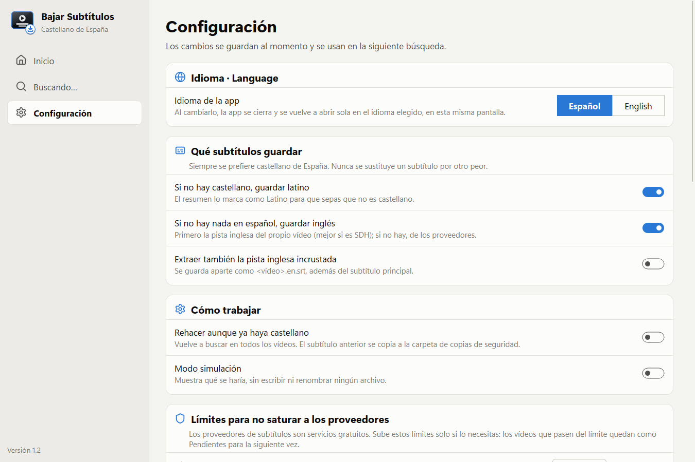

# Bajar Subtítulos ESP

Aplicación de escritorio para **Windows 10 y 11** que descarga subtítulos en **castellano
(español de España)** para tus series y películas. Arrastras un vídeo o una carpeta a la ventana
y se ocupa de todo, sin preguntas.


## Qué hace

- **Mira primero dentro del vídeo.** Si el `.mkv` o el `.mp4` trae una pista de subtítulos en
  castellano, la extrae. Es lo mejor, porque va sincronizada al milímetro. Lo hace sin ffmpeg y
  en segundos, aunque el vídeo ocupe varios GB.
- Si no la trae, **busca en internet**: OpenSubtitles (si tienes cuenta), Addic7ed, Gestdown y
  Subtitulamos. Descarga los mejores candidatos y se queda con el que es **castellano de verdad**.
  Para eso comprueba el vocabulario (vosotros, vale, móvil… frente a ustedes, celular, computadora…),
  porque las etiquetas de idioma de las webs no son fiables. También descarta los subtítulos de
  otro episodio o con una duración que no encaja.
- Prefiere **castellano > latino > inglés**, y nunca sustituye un subtítulo por otro peor. Si solo
  hay latino, o solo inglés, lo guarda y te lo marca en el resumen.
- Guarda el subtítulo como **`<vídeo>.srt`**, con el mismo nombre que el vídeo, para que cualquier
  reproductor lo cargue solo. Si sustituye uno que ya existía, guarda antes una copia de seguridad.
- **Respeta a los proveedores**: como mucho 40 vídeos buscan en internet en cada tanda y como
  mucho 5 descargas por vídeo, con una pausa entre vídeos. Lo que pase del límite queda como
  *Pendiente* para la próxima vez.

Hace exactamente lo mismo que la skill
[`bajar-subtitulos-esp`](https://github.com/subtitulos-castellano/bajar-subtitulos-esp) (para Claude
Code, Codex y OpenCode), de la que parte este proyecto.

## Instalar

Descarga la última versión desde **Releases**:

- **`BajarSubtitulosESP-<versión>-instalador.exe`**: lo instala para tu usuario (no pide permisos de
  administrador) y crea los accesos directos. Se desinstala desde *Configuración de Windows ›
  Aplicaciones*.
- **`BajarSubtitulosESP-<versión>-portable.zip`**: descomprímelo donde quieras y abre
  `BajarSubtitulosESP.exe`. No instala nada.

El programa no está firmado digitalmente, así que la primera vez Windows puede mostrar
**"Windows protegió su PC"**. Pulsa *Más información › Ejecutar de todas formas*.

### Comprobar la descarga

Cada Release incluye **`SHA256SUMS.txt`** con la huella SHA-256 de cada archivo. En PowerShell:

```powershell
Get-FileHash .\BajarSubtitulosESP-<versión>-instalador.exe
```

El resultado tiene que coincidir con la línea de ese archivo en `SHA256SUMS.txt`. Si no coincide, el
archivo está dañado o no es el original: no lo abras.

Desde la versión 1.0.1, cada archivo tiene además una **atestación de procedencia** de GitHub. Esta
atestación demuestra que el archivo lo compiló GitHub Actions a partir del código de este
repositorio, y no lo subió nadie a mano. Para comprobarla, con [GitHub CLI](https://cli.github.com/):

```powershell
gh attestation verify .\BajarSubtitulosESP-<versión>-instalador.exe -R subtitulos-castellano/bajar-subtitulos-esp-app
```

## Usar

1. **Arrastra** un vídeo, varios vídeos o una carpeta (con todas sus subcarpetas) a cualquier
   parte de la ventana. Lo que sueltas de una vez se revisa junto, como si estuviera en la misma
   carpeta. También puedes usar *Elegir carpeta…* o *Elegir vídeo…*.
2. La búsqueda empieza sola. Verás:
   - todos los vídeos en la tabla, primero *En espera*;
   - el que se está revisando, como *Buscando…*;
   - cómo cada uno cambia a su resultado.

   *Detalles* muestra lo que hace el programa por detrás. **Cancelar** para al momento (lo ya
   guardado se queda guardado). Si arrastras algo más mientras busca, se pone en cola.


3. Al terminar, el **resumen** muestra cuántos vídeos hay de cada tipo. Pulsa una tarjeta para ver
   solo esos vídeos. También puedes *Copiar resumen* o *Abrir carpeta*, y con *Inicio* vuelves a
   la pantalla del principio.

| Estado | Qué significa |
|---|---|
| 🟢 **Castellano** | Subtítulo en castellano guardado ahora (de internet o de una pista del propio vídeo) |
| 🟢 **Ya lo tenían** | Ya había un subtítulo en castellano: no se toca |
| 🟠 **Latino** | Solo había español latino y se ha guardado (se puede desactivar) |
| 🟠 **Inglés** | No había nada en español y se ha guardado inglés (se puede desactivar) |
| ⚪ **Sin cambios** | Ya tenía latino o inglés y no se ha encontrado nada mejor |
| 🟣 **Pendientes** | Superan el límite de vídeos por tanda: *Procesar pendientes* los busca |
| 🔴 **Sin subtítulos** | No se ha encontrado nada |


## Configuración

Los cambios se guardan al momento y se usan en la siguiente búsqueda.

| Opción | Por defecto |
|---|---|
| Si no hay castellano, guardar latino | Sí |
| Si no hay nada en español, guardar inglés (primero la pista del vídeo, mejor si es SDH) | Sí |
| Extraer también la pista inglesa incrustada como `<vídeo>.en.srt` | No |
| Rehacer aunque ya haya castellano | No |
| Modo simulación (muestra qué haría sin escribir nada) | No |
| Vídeos que buscan en internet en cada tanda | 40 |
| Candidatos que se descargan por vídeo | 5 |
| Cuenta de opensubtitles.org (opcional, da más resultados) | — |
| Tema: Sistema, Claro u Oscuro | Sistema |
| Tamaño del texto: como Windows o un porcentaje propio | Como Windows |
| Buscar actualizaciones automáticamente | Sí |



**Cuenta de OpenSubtitles:** es una cuenta de opensubtitles.org, no de opensubtitles.com. La
contraseña se guarda en el **Administrador de credenciales de Windows**, nunca en un archivo. Si
usas la skill, *Usar la cuenta de la skill* la importa de su `credenciales.json`.

**Tamaño del texto:** por defecto sigue a *Configuración de Windows › Accesibilidad › Tamaño del
texto*, como el Explorador. Si lo cambias allí, la app se ajusta al volver a ella.

### Actualizaciones

Al abrir la app, como mucho una vez al día, mira en GitHub si hay una versión nueva. Si la hay,
lo avisa arriba de la ventana, con sus novedades:

- **Actualizar** descarga el instalador y comprueba que su huella SHA-256 coincide con la que
  publica GitHub. Si coincide, la app se cierra, la versión nueva se instala sola y la app se vuelve
  a abrir. Si no coincide, no se instala nada.
- **Más tarde** cierra el aviso hasta la próxima vez que abras la app.
- Durante una búsqueda no se puede actualizar: espera a que termine.
- **Versión portable:** solo avisa y abre la página de descarga.

En *Configuración › Actualizaciones* puedes desactivar la comprobación automática o buscar ahora. La
app solo pregunta a GitHub por la última versión publicada, sin enviar nada tuyo.

## Dónde guarda cada cosa

| Qué | Dónde |
|---|---|
| Subtítulos | Junto a cada vídeo: `<vídeo>.srt` (y `<vídeo>.en.srt` si se pide) |
| Copias de los subtítulos sustituidos | `%USERPROFILE%\.subtitulos-esp\backup` (la misma carpeta que la skill) |
| Preferencias, tamaño y posición de la ventana | `%APPDATA%\BajarSubtitulosEsp\config.json` |
| Contraseña de OpenSubtitles | Administrador de credenciales de Windows (`BajarSubtitulosESP/opensubtitles`) |
| Instalador de la última actualización y su registro | `%TEMP%\BajarSubtitulosESP-actualizacion` (se borra solo) |

Al desinstalar, todo esto se conserva: es tuyo y lo comparte la skill.

## Preguntas frecuentes

**No me aparece el aviso de la versión nueva.** La comprobación se hace como mucho una vez al
día. Usa *Configuración › Actualizaciones › Buscar ahora*. La versión 1.0.0 aún no sabía
actualizarse: si la tienes, instala la última a mano una vez.

**Un proveedor da error (por ejemplo, "HTTP error 503. Provider addic7ed" en Detalles).** Ese
servicio no está disponible en ese momento. La app sigue con los demás. Si un vídeo se queda sin
castellano por eso, vuelve a intentarlo más tarde.

**Se ha quedado en latino o en inglés y luego aparece el castellano.** Arrastra la carpeta otra
vez: los vídeos que ya tienen castellano se saltan enseguida y los demás se vuelven a buscar. El
latino o el inglés se sustituyen por castellano en cuanto aparece.

**Quiero revisar más de 40 vídeos de una vez.** Usa *Procesar pendientes* al terminar o, si de
verdad lo necesitas, sube el límite en Configuración. Los proveedores son servicios gratuitos:
mejor no saturarlos.

**¿Sube o comparte algo de mis vídeos?** No. Solo consulta a los proveedores el nombre del
episodio o de la película, y lee los vídeos desde tu disco.

---

## Desarrollo

### Estructura

```
app/            interfaz gráfica (Qt / PySide6)
  main.py       arranque (--tema, --demo, --captura, --config, --autoprueba)
  ventana.py    ventana principal, menú lateral, arrastrar y soltar, cola
  vista_inicio.py  zona de arrastre, búsqueda en curso y resumen con colores
  vista_ajustes.py Configuración
  trabajador.py procesar() en un hilo; señales, avisos y cancelación inmediata
  componentes.py   interruptor, tarjetas, barras, tabla de vídeos
  config.py     preferencias (%APPDATA%\BajarSubtitulosEsp\config.json)
  credenciales.py  cuenta de OpenSubtitles (keyring)
  actualizar.py consultar la última Release, descargar y verificar el instalador y lanzarlo (sin Qt)
  vista_actualizacion.py  aviso de versión nueva y comprobación/descarga en hilos aparte
  tema.py       colores claro/oscuro, tamaño del texto y hoja de estilos
  iconos.py     iconos SVG (Lucide, ISC)
  demo.py       resultados de demostración (--demo, --captura)
subtitulos/     núcleo, compartido con la línea de comandos
  archivos.py   qué es un vídeo, buscar en varias rutas, carpeta de datos
  eventos.py    Resultado, Eventos y categorías del resumen
  opciones.py   Opciones de una búsqueda (= los parámetros de la CLI)
  texto.py      limpieza de textos de terceros, idioma y dialecto
  pistas.py     subtítulos incrustados en MKV y MP4 (sin ffmpeg)
  nucleo.py     proveedores y procesar(ruta(s), opciones, eventos, cancelado, credenciales)
bajar_subs.py   línea de comandos (mismos parámetros y salida que la skill)
packaging/      PyInstaller, Inno Setup, recursos y compilar.py
scripts/windows.sh  desarrollo desde WSL con el Python de Windows
tests/          pruebas (núcleo, seguridad, app)
```

Todos los módulos de `subtitulos/`, menos `nucleo.py`, solo usan la biblioteca estándar. La
ventana aparece en ~0,6 s y subliminal se carga en segundo plano después.

### Desarrollo desde WSL

La app se ejecuta con el Python de Windows. `scripts/windows.sh` copia el código a
`C:\Users\<usuario>\dev\bajar-subtitulos-esp-app` y lo ejecuta allí:

```bash
scripts/windows.sh entorno     # una vez: crea el venv de Windows (requirements-app.txt)
scripts/windows.sh app         # abre la app
scripts/windows.sh app --demo  # con resultados de demostración (no busca ni descarga)
scripts/windows.sh python -I app/main.py --captura 'C:\ruta\capturas'   # imágenes de cada pantalla
scripts/windows.sh compilar    # .exe, zip portable (e instalador si hay Inno Setup) en dist/
```

### Línea de comandos

```bash
python -I bajar_subs.py "<carpeta o vídeo>" [--dry-run] [--force] [--solo-castellano]
                       [--sin-ingles] [--ingles] [--max-videos N] [--max-descargas N]
```

### Pruebas

```bash
python -m unittest discover -s tests                        # núcleo (las de la app se saltan sin PySide6)
scripts/windows.sh python -I -m unittest discover -s tests  # todas, con el Python de Windows
```

- `tests/test_nucleo.py` simula los proveedores, así que no necesita internet. Comprueba que la
  CLI da **exactamente** la misma salida y los mismos archivos que el script original de la skill
  (`tests/esperado/`). También cubre:
  - cancelar durante una consulta;
  - rutas con acentos y muy largas;
  - no tener conexión;
  - proveedores caídos;
  - varias rutas a la vez.
- `tests/test_seguridad.py`: vídeos y textos manipulados.
- `tests/test_app.py`: la app sin mostrar ventanas. Cubre:
  - configuración y credenciales;
  - qué se acepta al soltar;
  - el trabajador en su hilo;
  - el menú lateral y la tabla progresiva;
  - la posición de la ventana y el tamaño del texto.

### Compilar y publicar

`packaging/compilar.py` hace, en orden:

1. Genera el icono, la versión del `.exe` y los avisos de licencias.
2. Compila con PyInstaller en modo carpeta, sin UPX y sin `-O`.
3. Ejecuta la **autoprueba del `.exe` empaquetado**: proveedores, refinadores, idiomas, keyring,
   certificados, una búsqueda sin red con un MKV y una ruta larga con acentos.
4. Crea el zip portable y, si está Inno Setup, el instalador (`packaging/instalador.iss`).

`<exe> --autoprueba informe.txt --con-red` añade una búsqueda real (en simulación) contra los
proveedores.

**GitHub Actions** (`.github/workflows/compilar.yml`) hace tres cosas:

1. Compila.
2. Prueba lo compilado en **Windows Server 2022** (base de Windows 10) y **2025** (base de
   Windows 11): pruebas, instalación silenciosa, autoprueba del programa instalado y del portable,
   y desinstalación sin restos.
3. Con una etiqueta `vX.Y.Z`, publica la Release con las notas de `CHANGELOG.md`, junto con
   `SHA256SUMS.txt` y la atestación de procedencia de cada archivo.

Para publicar una versión:

1. Sube `__version__` en `app/__init__.py`.
2. Añade la versión a `CHANGELOG.md`.
3. Haz commit y luego `git tag vX.Y.Z && git push --tags`.

### Traer mejoras de la skill

El remoto `upstream` apunta al repositorio de la skill, y está configurado para no poder subir
nada a él. Su `bajar_subs.py` está repartido aquí en el paquete `subtitulos/`, así que las mejoras
se portan a mano:

```bash
git fetch upstream
git diff 3aa1f5e upstream/main -- bajar_subs.py    # 3aa1f5e: último commit de la skill incorporado
```

Cada cambio se aplica en su módulo:

- `pistas.py`: pistas incrustadas.
- `texto.py`: idioma y dialecto.
- `nucleo.py`: proveedores y `procesar()`.
- `bajar_subs.py`: parámetros.

Al terminar, actualiza aquí el último commit incorporado.

## Licencia

MIT (ver `LICENSE`). Qt/PySide6 se distribuye bajo LGPL v3, como librerías separadas dentro de la
carpeta `_internal`. Iconos de Lucide (ISC). La lista completa de componentes y licencias va con
el programa, en `AVISOS_TERCEROS.txt`.
